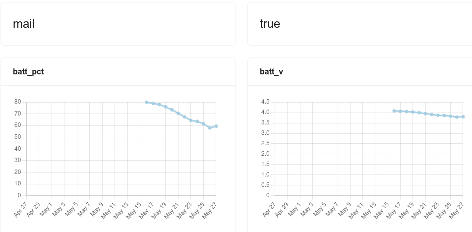
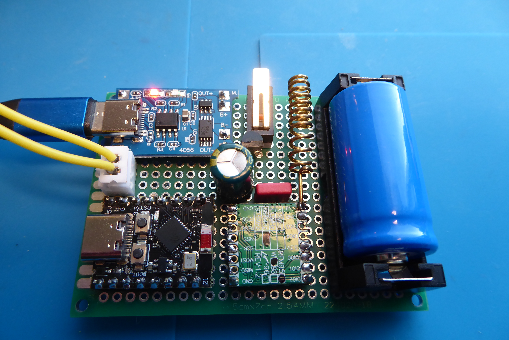

# Postihaly – LoRaWAN Mailbox Alert (ESP32-C3 SuperMini)

Battery-powered mailbox alert system using **ESP32-C3 SuperMini** + RFM95W-868S2 + microswitch.

The microswitch detects when the mailbox lid is opened and sends an alert via LoRaWAN to ChirpStack → Telegraf → InfluxDB → Grafana → email notification.


## Version History

### v1.0.1 (2026-05-27)
- **Power optimization**: Voltage divider GND switched via GPIO10 (`BATT_GND_SWITCH_GPIO`) – eliminates ~16.5 µA quiescent drain
- **Battery isolation**: TP4056 module disconnected via enclosure microswitch (opens when lid is removed for charging)
- **Decoder fix**: Corrected battery voltage calculation in ChirpStack decoder (`1.35` → `1.2` multiplier)

### v1.0.0 (Initial release)
- Basic mailbox open detection + heartbeat functionality
- LoRaWAN OTAA join with session persistence in RTC + NVS
- Grafana/Telegraf/InfluxDB integration


*First test setup*


*First 10 days test showed issues with power consumpion*

---

## Hardware (Current Version)

| Ref | Component | Description |
|-----|-----------|-------------|
| BT1 | NCR18650 Li-Ion 3.7 V | Battery |
| U1 | ESP32-C3 SuperMini | Microcontroller |
| U3 | RFM95W-868S2 | LoRa radio module |
| SW1 | Microswitch (NO) | Mailbox lid sensor (GPIO2, HIGH = open) |
| SW2 | Microswitch (NC) | **TP4056 isolation** – opens when enclosure is opened for charging |
| R5,R6 | 100 kΩ | Battery voltage divider (GPIO1 ADC, GND via GPIO10) |

---

### Important Notes for ESP32-C3 SuperMini

- **Status LED**: The blue LED does not turn off easily via GPIO (GPIO8/9). **Recommendation: desolder the LED** for minimum power consumption.
- **USB Monitoring**: Use `tio` tool (PlatformIO/VS Code built-in monitor disconnects during deep sleep).
- **Wake-up**: GPIO2 works reliably as deep sleep wake-up pin.
- **ADC**: GPIO1 for battery voltage measurement (works well with Two Point calibration).

### ADC & Battery Measurement
- GPIO1 for battery voltage measurement (works well with Two Point calibration)
- **Voltage divider GND is switched via GPIO10** – active only during measurement (~20 ms), zero quiescent drain in sleep
- Formula: `Vbatt = Vadc × 2.0` (100k+100k divider)

### TP4056 Isolation Switch (SW2)
To eliminate the TP4056 module's quiescent current (~1–10 mA on cheap boards):
- A **normally-closed (NC) microswitch** is placed between TP4056 B+ and battery +
- **Enclosure closed**: switch pressed → battery connected to TP4056 + ESP32
- **Enclosure opened** (for charging): switch released → battery disconnected from TP4056, eliminating module drain
- **Charging procedure**: Open enclosure → connect USB to TP4056 → charge → close enclosure to resume operation

> ⚠️ **Warning**: Do not leave the enclosure open during normal operation – the device will not charge and the switch may wear.


*Microswitch opens when the enclosure is opened*

### Proper platform.ini file

```text
[env:esp32dev]
platform = espressif32
board = esp32-c3-devkitc-02
framework = arduino
monitor_speed = 115200
upload_port = /dev/ttyACM0
monitor_port = /dev/ttyACM0
monitor_filters = direct 
monitor_rts = 0        
monitor_dtr = 0       
build_flags =
  -D CORE_DEBUG_LEVEL=4
  -D ARDUINO_USB_CDC_ON_BOOT=1
  -D ARDUINO_USB_MODE=1
upload_speed = 921600
board_build.partitions = min_spiffs.csv
lib_deps =
    jgromes/RadioLib@^7.3.0
    ArduinoOTA
```

## Pin Assignments (ESP32-C3 SuperMini)

| GPIO | Signal       | Description |
|------|--------------|-----------|
| 2    | SWITCH       | Microswitch (HIGH = lid open) |
| 1    | BATT_ADC     | Battery voltage divider |
| 6    | SPI_SCK      | RFM95W |
| 7    | SPI_MISO     | RFM95W |
| 3    | SPI_MOSI     | RFM95W |
| 5    | RFM_CS       | RFM95W Chip Select |
| 4    | RFM_DIO0     | (not necessarily used) |
| 10   | BATT_GND_SW  | Switched GND for voltage divider (v1.0.1+) |

Pins, application ID etc. are assigned in settings.h file.

## Power Consumption

Battery life estimate (2500 mAh Li-Ion, 12 h heartbeat):
- Theoretical: 2500 mAh / 0.05 mA ≈ 50 000 h ≈ 5.7 years
- Realistic (including transmissions, self-discharge): 1.5–3 years

With TP4056 isolation switch + switched voltage divider, multi-year operation is achievable.


## Monitoring (Recommended)

```bash
# Install tio (excellent serial monitor)
cargo install tio

# Start monitoring
tio -b 115200 /dev/ttyACM0
```

Note: PlatformIO / VS Code built-in monitor often loses connection when the device enters deep sleep. tio is much more reliable with ESP32-C3 SuperMini.


# Payload

Device Profiles - Codec:

```java
function decodeUplink(input) {
  var bytes = input.bytes;
  
  if (bytes.length < 2) {
    return { data: { error: "payload too short" } };
  }

  // Parse battery percentage (sent directly from ESP32)
  var battery_pct = bytes[1];
  
  // Use same 1.2V range as ESP32 (3.0V–4.2V)
  var pct = battery_pct / 100.0;
  var battery_v = parseFloat((3.0 + pct * 1.2).toFixed(2));

  // Event parsing
  var event, mail_present;
  switch (bytes[0]) {
    case 0x01:
      event = "mail";
      mail_present = true;
      break;
    case 0x02:
      event = "heartbeat";
      mail_present = false;
      break;
    default:
      event = "unknown";
      mail_present = null;
  }

  return {
    data: {
      // Telegraf/Grafana-compatible fields
      batt_v: battery_v,
      batt_pct: battery_pct,
      event: event,
      mail_present: mail_present,
      
      // Aliases for dashboard compatibility
      battery: battery_v,
      batteryLevel: battery_pct,
      battery_voltage: battery_v
    }
  };
}Source code at [Codeberg](https://codeberg.org/hiltsu/lorawan/src/branch/main/ESP32/PlatformIO/PostboxAlarm/src) 
```

## Payload Format (2 bytes, fPort=1)

```text
Byte,Content
0,"Event type: 0x01 = mail, 0x02 = heartbeat"
1,Battery percentage (0–100)
```

### Downlink Commands (fPort=1)

Bytes,Action
01 HH LL,"Set heartbeat interval (seconds, big-endian)"
02,Enter OTA mode (5 min timeout)
02 MM,Enter OTA mode (MM minutes)

# Build & Upload (PlatformIO)

pio run -e esp32c3_supermini --target upload
tio -b 115200 /dev/ttyACM0

# OTA Updates
Send downlink command 0x02. On the next wake-up the device will connect to WiFi and start ArduinoOTA server.

