# LoRaWAN Project — Image Gallery

Visual documentation of hardware, wiring, and ChirpStack configuration.  
Images are organized to match the repository directory structure.

---

## LoRaWAN Node — ESP32 + RFM95W + BME280

### Hardware Photos

| Image | Description |
|-------|-------------|
| 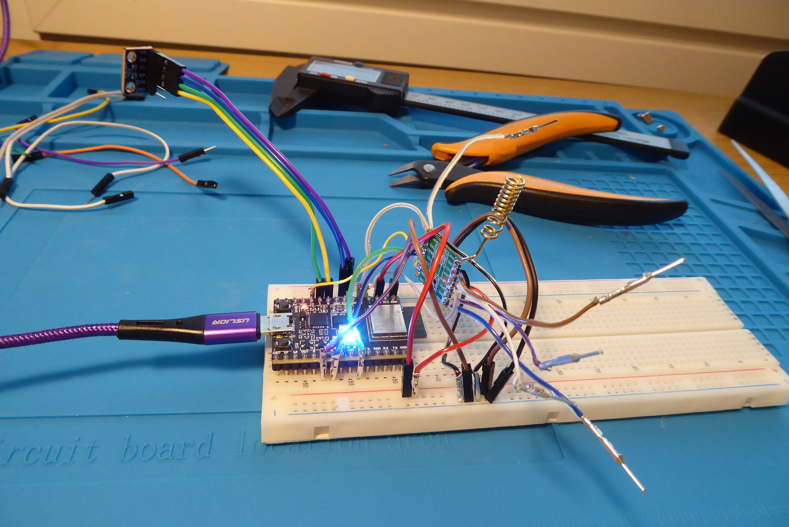 | **Dev board test setup** — Initial wiring test using a full-size ESP32 development board, verifying SPI (RFM95W) and I²C (BME280) connectivity before committing to a smaller form factor. |
| 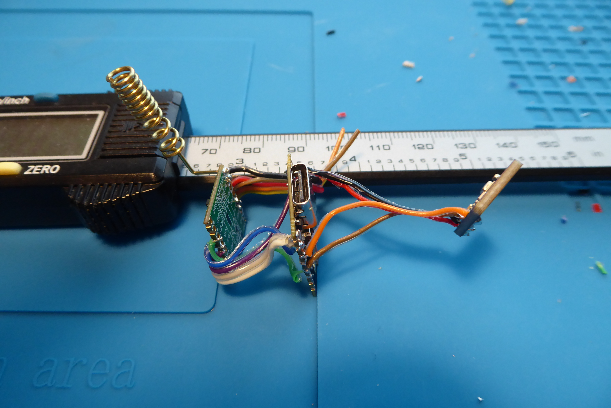 | **ESP32 SuperMini — size comparison** — The ESP32-S2/C3 SuperMini next to the dev board, illustrating the footprint reduction achievable for a field-deployed node if SuperMini is sufficient. |
| 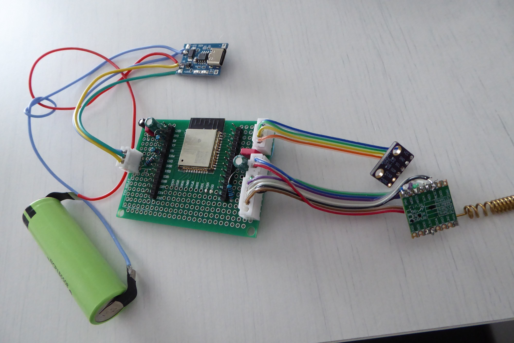 | **First ULP prototype** — Assembled node on perfboard: ESP32 module, RFM95W LoRa radio (helical antenna), BME280 environmental sensor (I²C), Panasonic NCR18650B cell, and TP4056 USB-C charger module (replaced to CN3791 MPPT module). Connectors allow modular assembly.  |
| 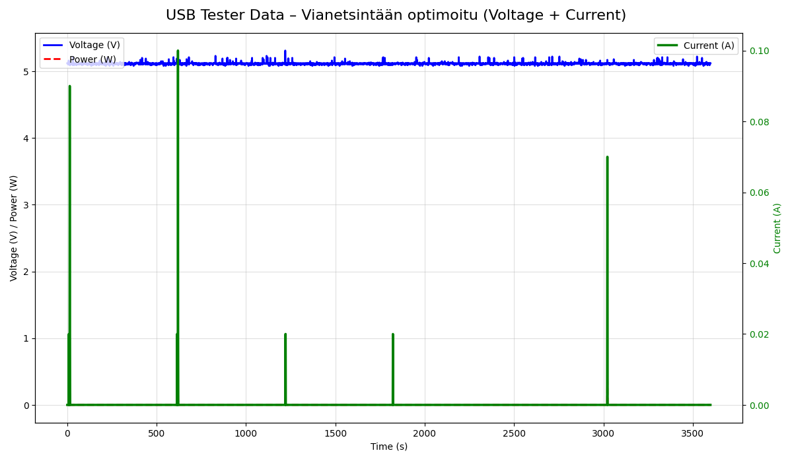 | **Current consumption profile** — Oscilloscope / logger trace showing the node's power draw over time. Visible spikes correspond to the ESP32 waking from deep sleep, performing a BME280 measurement, and transmitting the LoRaWAN uplink via RFM95W, followed by a return to ULP sleep. |

### Example ChirpStack Metrics — First 24 h Run

| Image | Description |
|-------|-------------|
| 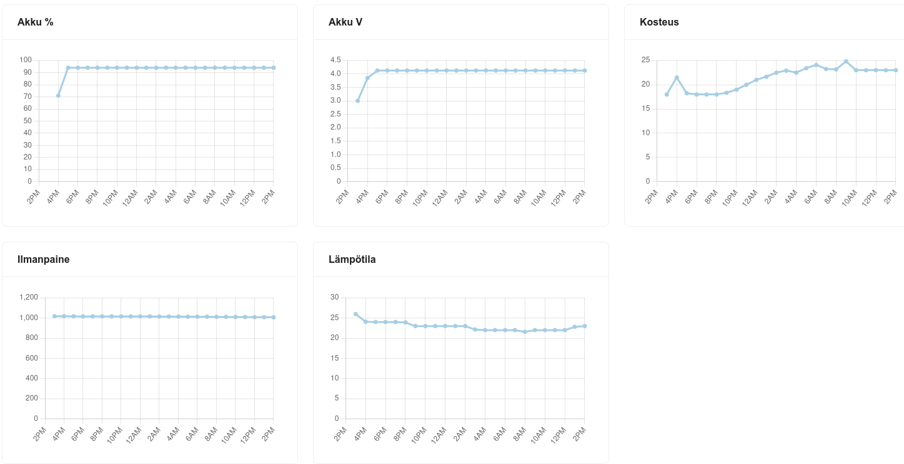 | **Device metrics — first 24 h** — Battery (% and V), relative humidity, air pressure, and temperature as reported by the node over the first ~24-hour period. Battery stabilises at ~4.10 V / 93–95 % confirming effective deep sleep power management. |
| 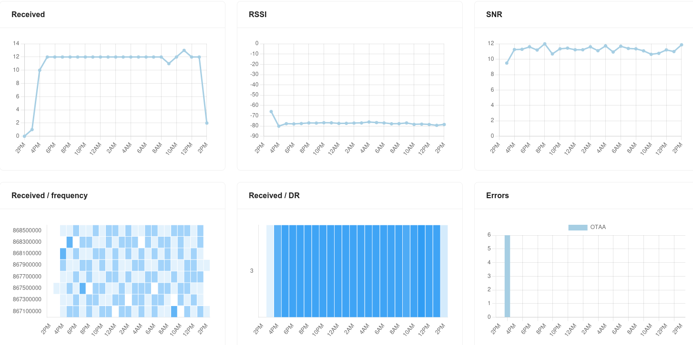 | **Link metrics — first 24 h** — Received frame count, RSSI (stable ~−80 dBm), SNR (~10–12 dB), per-frequency heatmap across EU868 channels, data rate distribution (DR3 / SF9BW125), and OTAA join error count at startup. |

### Schematic

| Image | Description |
|-------|-------------|
|  | **ULP node schematic** — Full circuit diagram of the ESP32 + RFM95W + BME280 node including battery management, decoupling, SPI/I²C wiring, and deep sleep enable/disable logic. Drawn in [KiCad](https://www.kicad.org/); source project files are available in [`ESP32/ULP Electrnic Design/KiCad/`](ESP32/ULP%20Electrnic%20Design/KiCad). |

---

## LoRaWAN Gateway — Raspberry Pi 5 + Seeed Studio WM1302

### Hardware Photos

| Image | Description |
|-------|-------------|
| 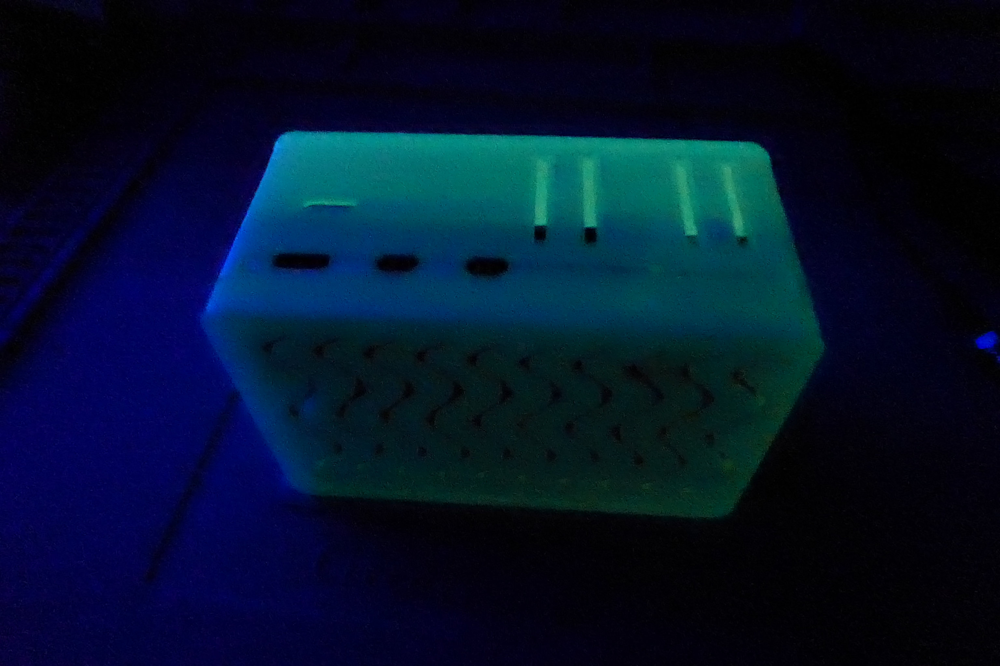 | **3D-printed enclosure** — Custom FDM-printed case designed in Fusion 360. Source files at [Codeberg](https://codeberg.org/hiltsu/fusion360-piirrokset-3D-tulostusobjektit/src/commit/edc14014b9645622f2213bedf9648764ba252b18/RaspberryPi5_SeedStudio_WM1302_V1) and at [Autodesk](https://outlook37929.autodesk360.com/g/shares/SH90d2dQT28d5b602811a7db2537dd011f85). Provides mechanical protection and ventilation for outdoor/semi-outdoor placement. |
| 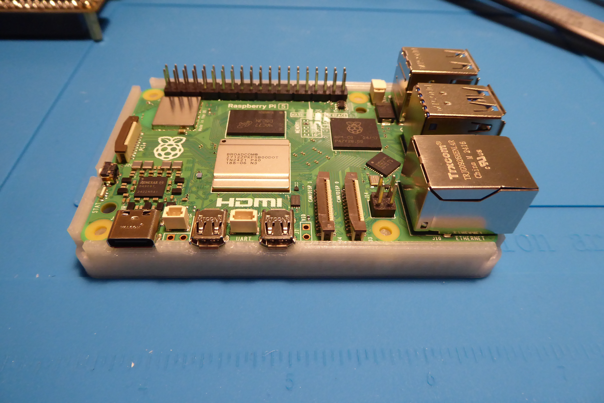 | **Raspberry Pi 5 fitted in case** — Pi mounted inside the printed enclosure before the WM1302 HAT is attached. |
| 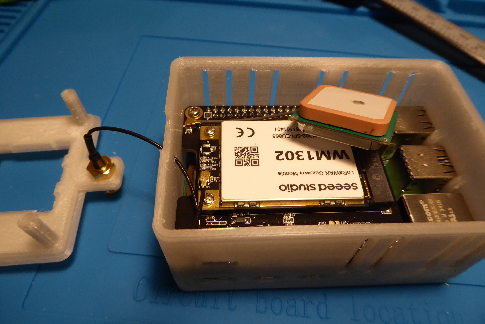 | **WM1302 HAT installed** — Seeed Studio WM1302 LoRaWAN concentrator HAT seated on the 40-pin GPIO header. SPI interface and power rails verified. |
| 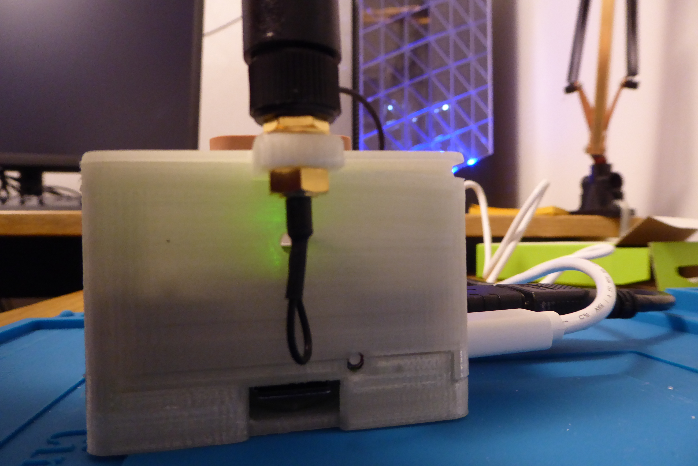 | **External antenna mounting** — Antenna connector routed through the enclosure wall. An external 868 MHz antenna provides better link budget compared to a stub/helical. |
| 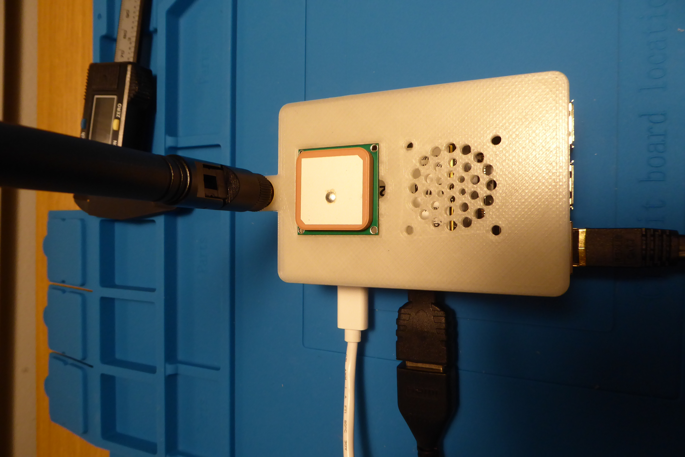 | **Complete gateway assembly** — Fully assembled gateway with all components: Pi 5, WM1302 HAT, antenna, and power supply inside the printed case. |
| 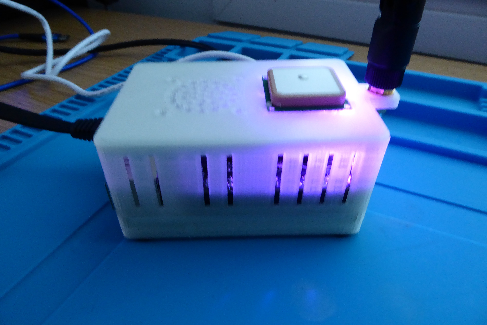 | **Normal operation** — Gateway running ChirpStack Gateway Bridge, LEDs indicating active packet forwarding. |
| 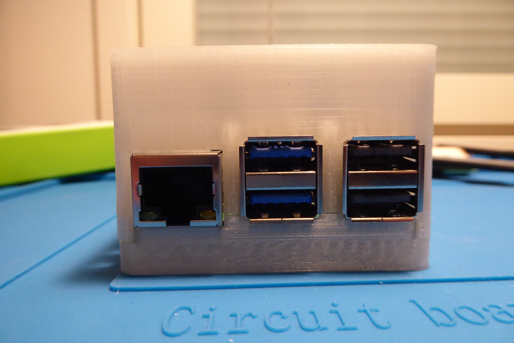 | **Ethernet port side** — Case cutout giving access to the Pi's RJ45 Ethernet port for wired backhaul connectivity. |
| 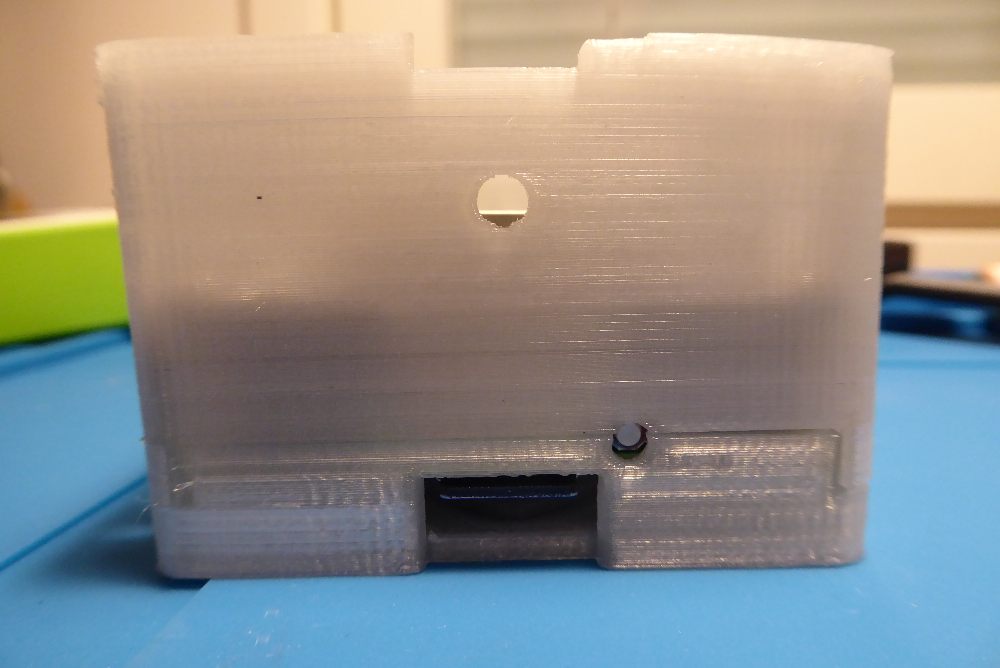 | **SD card slot side** — Case cutout for microSD card access without disassembly. |

For the ESP32 ULP node,see article [The Stevenson Shield for ESP32 LoRaWAN Weather Station — Parametric 3D-Printed Enclosure](https://hiltsu.codeberg.page/en/posts/stevenson-shield-esp32-lorawan/)

---

## ChirpStack Network Server

### Gateway View

| Image | Description |
|-------|-------------|
|  | **Gateway dashboard** — ChirpStack gateway overview: online status, last seen timestamp, location, and received/transmitted packet counters. |
|  | **Gateway — LoRaWAN frames** — Raw frame log at the gateway level showing uplink/downlink metadata: frequency, DR, RSSI, SNR, MIC, DevAddr. Useful for diagnosing join or transmission issues. |

### Device Profiles

| Image | Description |
|-------|-------------|
|  | **Device profile — General tab** — Configuration of the EU868 regional parameters, MAC version (LoRaWAN 1.0.x), OTAA join type, ADR enable/disable, and Class A uplink interval. |
|  | **Device profile — Measurements tab** — Decoded measurement field definitions mapped to Cayenne LPP channels: temperature, humidity, barometric pressure, battery voltage, and battery percentage. |

### Applications / Devices

| Image | Description |
|-------|-------------|
|  | **Device metrics — beginning of data** — ChirpStack device dashboard shortly after first successful OTAA join and uplink, showing initial values for all configured measurement channels. |
|  | **Events — decoded frame payload** — The Events tab with an uplink frame expanded: raw base64 FRMPayload decoded into human-readable sensor values (temp, hum, pres, battery) via the ChirpStack JavaScript payload codec. |
|  | **Application-level link metrics** — Per-device link quality statistics aggregated at the application layer: RSSI/SNR trends and frame success rate over time. |
|  | **Poll interwall change** — after downloading hex 010384 upload interwall is changed from 5 minutes to 15 minutes. |

---

## InfluxDB

| Image | Description |
|-------|-------------|
| 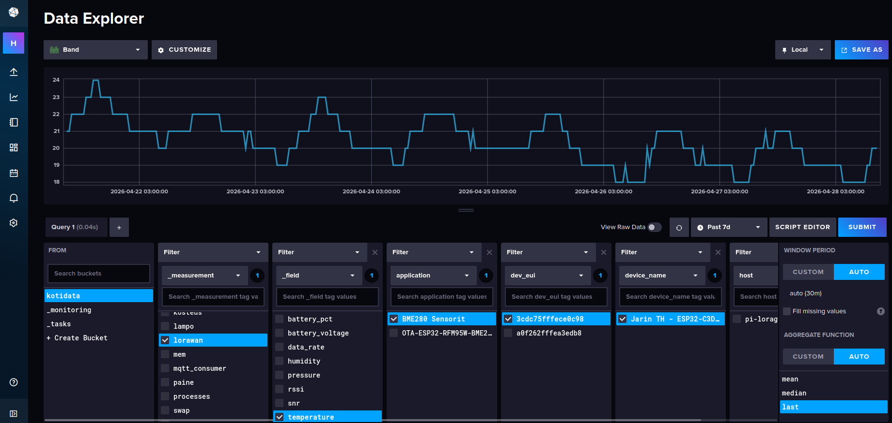 | **Example measurement query** — InfluxDB data explorer showing a `lorawan` measurement query with field filters applied. Demonstrates the data structure written by Telegraf from the ChirpStack MQTT uplink stream. |
| 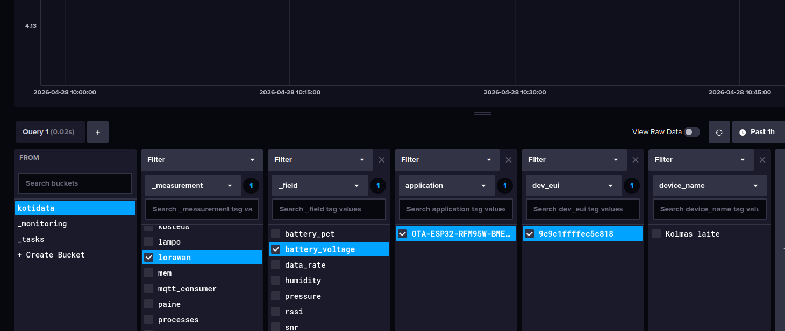 | **Tag configuration** — Available tag keys in the `lorawan` measurement: `dev_eui`, `device_name`, `application`, and `location`. Tags enable efficient per-device filtering in Grafana without full table scans. |

---

## Grafana

| Image | Description |
|-------|-------------|
| 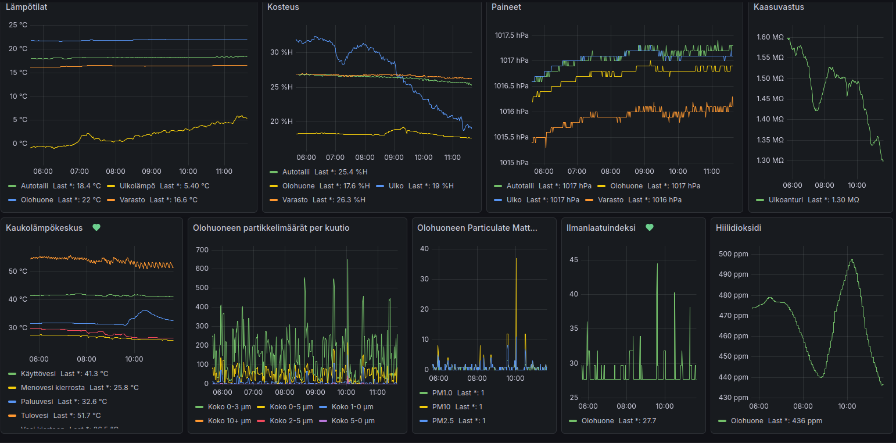 | **Home measurement dashboard** — Grafana panel showing temperature, humidity, air pressure, and battery readings from the LoRaWAN node. Data sourced from InfluxDB via Flux queries; panels update automatically as new uplinks arrive. |
| 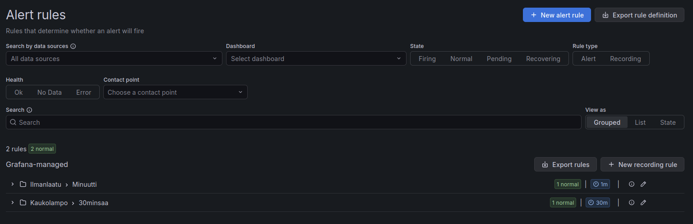 | **Alert rule example** — Grafana alerting configuration for a LoRaWAN sensor threshold (e.g. battery low or temperature out of range). Demonstrates rule definition, evaluation interval, and notification contact point setup. |

---

## Troubleshooting Reference

| Image | Description |
|-------|-------------|
| 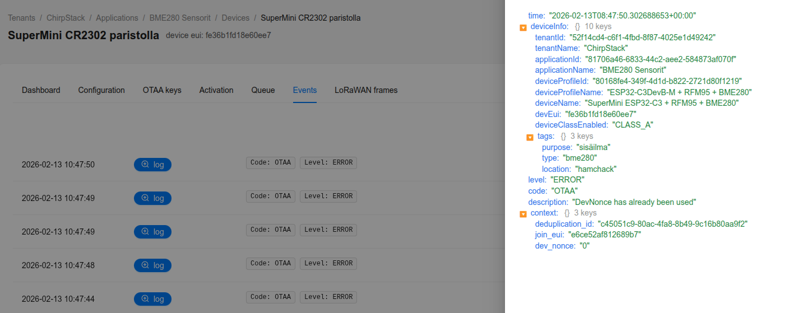 | **OTAA join error — "NwkKey already used"** — ChirpStack rejecting a join request because the device nonce (DevNonce) had already been seen. Occurs when the node is reset or reflashed without a factory reset on the ChirpStack side. **Fix:** delete and re-register the device in ChirpStack, or enable "Disable frame-counter validation" temporarily during development. |

---

## Notes on Image Organisation

- `_images/Chirpstack/` contains ChirpStack screenshots including setup phase images (February 2026) and metrics from the first 24-hour ULP prototype run (April 2026).
- `_images/Grafana/` contains Grafana dashboard and alerting examples (April 2026).
- `_images/InfluxDB/` contains InfluxDB data explorer and tag configuration examples (April 2026).
- All hardware photographs are original. The node schematic was drawn in [KiCad](https://www.kicad.org/); source files are in [`ESP32/ULP Electrnic Design/KiCad/`](ESP32/ULP%20Electrnic%20Design/KiCad).
